# Vision-Based Customer Trajectory Analytics for Retail Layout Optimization

> **Academic Research & Engineering Implementation · Master of Computer Applications (MCA)**  
> **Course:** CAF7104 — Mini Project, Department of Computer Applications  
> **Candidate:** Kaniga Parameswaran R (Reg. No: 250282601051)  
> **Institution:** B.S. Abdur Rahman Crescent Institute of Science and Technology, Chennai – 600 048  
> **Author Portfolio:** [kanigaparameswaran.netlify.app](https://kanigaparameswaran.netlify.app/) · [GitHub Profile](https://github.com/KanigaKP)  
> **Target Repository:** [Vision-Based-Customer-Trajectory-Analytics](https://github.com/KanigaKP/Vision-Based-Customer-Trajectory-Analytics)  
> **Automated Verification:** **428 / 428 Tests Passing (100% Pass Rate)** · Zero Regressions  

---

## 1. Project Overview & Problem Statement

Traditional retail analytics rely on aggregate entrance sensors or infrared break-beams. While these tools tally total entries, they provide no visibility into customer navigation, aisle occupancy, display dwell times, or dead zones across a retail floor. Conversely, modern computer vision solutions frequently require expensive cloud APIs, power-hungry GPUs, or intrusive biometric tracking that risks customer privacy.

**Vision-Based Customer Trajectory Analytics** is an explainable, local-first computer vision prototype that transforms standard overhead or angled retail surveillance video into spatial customer trajectories and dwell analytics. The system operates on commodity CPU hardware without cloud dependencies, processing video through an offline single-camera pipeline:

1. **Lightweight Person Detection:** Identifies customers frame-by-frame using an ONNX-optimized YOLO11-nano model running on local CPU.
2. **Multi-Object Tracking:** Maintains clip-local customer identities across occlusions and motion using a Kalman-filter-based ByteTrack implementation.
3. **Planar Homography Projection:** Maps image-plane foot-contact points $(x_{\text{center}}, y_{\text{bottom}})$ onto metric floor coordinates using Singular Value Decomposition (SVD).
4. **Hysteresis-Stabilized Zone Assignment:** Assigns customers to user-defined retail zones with a 3-frame temporal buffer to suppress boundary flicker.
5. **Point-Conserving Density Grids:** Accumulates movement density across discretized spatial cells with a strict point-conservation invariant.
6. **Continuous Dwell Episode Extraction:** Quantifies sustained customer presence at physical displays, distinguishing transient aisle passage from shopping dwell.
7. **Markovian Zone Transitions:** Analyzes department-to-department journey paths and transition probabilities.
8. **Candidate Placement Diagnostics:** Pinpoints underutilized high-traffic floor cells for promotional display placement, with automated evidence gating.
9. **Interactive Dashboard:** Delivers insights through a Streamlit web application featuring a 2D synchronized timeline player and an interactive 3D Spatial Analytical Studio.

---

## 2. Engineering Objectives & Technical Boundaries

To maintain scientific rigor and operational transparency, this implementation enforces clear engineering boundaries:

| Dimension | Engineering Specification | Implementation Boundary |
| :--- | :--- | :--- |
| **Execution Environment** | 100% Local CPU via ONNX Runtime & OpenCV | Zero external cloud APIs, telemetry, or dedicated GPU requirements |
| **Privacy Safeguards** | Bounding box foot points & anonymous track IDs | No facial recognition, biometrics, or cross-session re-identification |
| **Coordinate Reference** | User-defined bounding quadrilateral $(P_1 \dots P_4)$ | Planar homography calculates configured floor units, not surveyed GPS or laser meters |
| **Ground Contact** | Bottom-center bounding box $(x_c, y_{\max})$ | Maps floor plane contact; elevated shelf reach or cart interaction is unmodeled |
| **Transition Logic** | First-order Markov chain across recorded frames | Unassigned points (`None`) break transition chains; observation gaps reflect missing samples |
| **Decision Support** | Empirical dwell/density candidate ranking | Commercial revenue or sales impact is withheld without point-of-sale data integration |

---

## 3. System Architecture

The project is structured into three decoupled layers: presentation, adapter, and the core analytics engine:

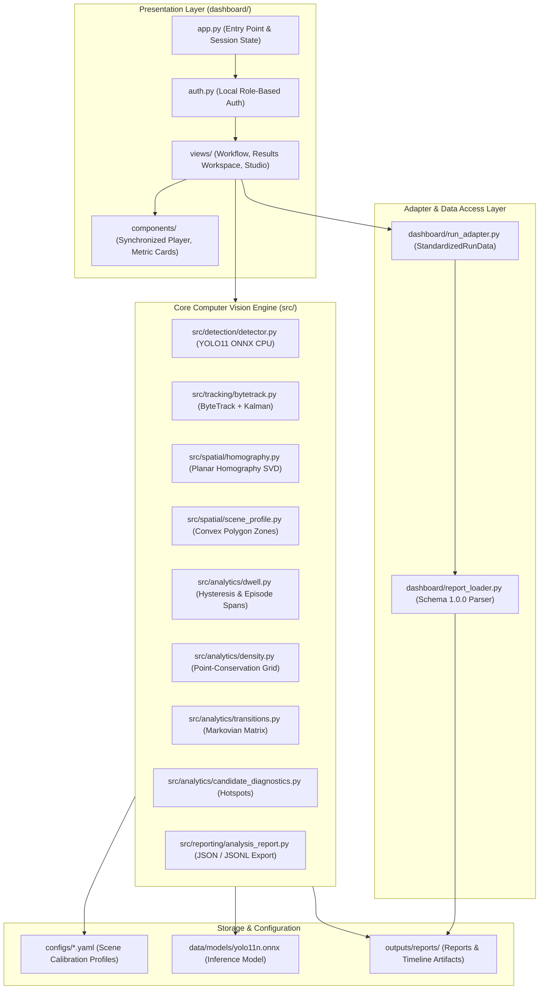

---

## 4. End-to-End Video Analysis Pipeline

Video processing progresses through sequential transformation stages from raw surveillance decoding to structured JSON reports:

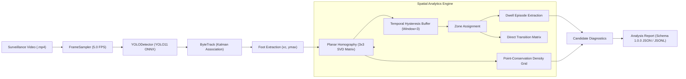

---

## 5. Methodology & Algorithmic Implementation

### 5.1 Person Detection via YOLO11-nano ONNX
- **Inference Runtime:** `onnxruntime.InferenceSession` configured with CPU execution providers.
- **Preprocessing:** Resizes input video frames to fixed dimensions ($640 \times 640$) using bilinear interpolation with letterbox aspect-ratio padding. Pixel intensities are normalized to $[0.0, 1.0]$.
- **Inference Filtering:** Retains class ID `0` (Person). Bounding boxes are filtered by confidence threshold ($c \ge 0.25$) and non-maximum suppression (NMS) with an IoU threshold of $0.45$.
- **Detection Result:** Emits `DetectionResult(bbox=[x1, y1, x2, y2], confidence=c, class_id=0)` for every detected individual.

### 5.2 Multi-Object Tracking via ByteTrack
- **State Space Model:** Kalman filter maintains an 8-dimensional state vector for each tracklet:
  $$\mathbf{x} = [x, y, a, h, \dot{x}, \dot{y}, \dot{a}, \dot{h}]^T$$
  where $(x, y)$ represents bounding box center, $a$ is aspect ratio ($w/h$), and $h$ is bounding box height.
- **Dual-Threshold Association:**
  1. *First Association:* High-confidence detections ($c \ge 0.5$) are matched with active tracks using the Hungarian algorithm based on bounding box IoU distance.
  2. *Second Association:* Unmatched tracks are matched against low-confidence detections ($0.1 \le c < 0.5$) to recover partially occluded shoppers without creating spurious track fragments.
  3. *Track Management:* Unmatched tracks are marked lost for up to 30 frames before removal.

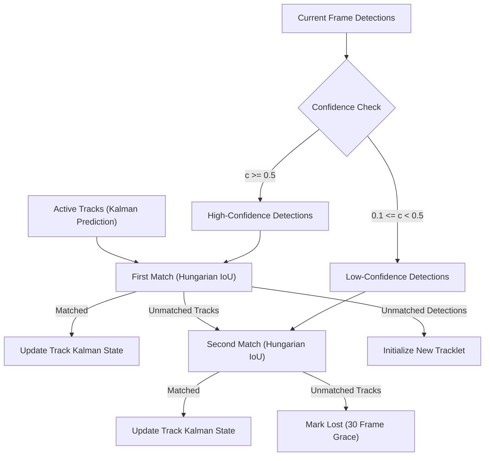

### 5.3 Planar Homography & Floor Projection
Retail cameras view aisles at oblique angles, causing perspective distortion where distant shoppers appear smaller and move fewer image pixels per meter. To recover physical floor positions:
1. **Ground Contact Extraction:** The ground contact point is calculated from the bottom-center of the person's bounding box:
   $$u = \frac{x_1 + x_2}{2}, \quad v = y_2$$
2. **Homography Computation:** A $3 \times 3$ perspective transformation matrix $\mathbf{H}$ maps image coordinates $(u, v)$ to metric floor coordinates $(X, Y)$:
   $$\begin{bmatrix} X' \\ Y' \\ W' \end{bmatrix} = \mathbf{H} \begin{bmatrix} u \\ v \\ 1 \end{bmatrix}, \quad X = \frac{X'}{W'}, \quad Y = \frac{Y'}{W'}$$
3. **Singular Value Decomposition (SVD):** $\mathbf{H}$ is derived by solving $\mathbf{A} \mathbf{h} = 0$ using SVD on four configured image-to-floor correspondence points $(P_1, P_2, P_3, P_4)$.
4. **Validation Constraints:** Quadrilaterals are strictly validated against collinearity, self-intersection, and extreme aspect ratio distortion.

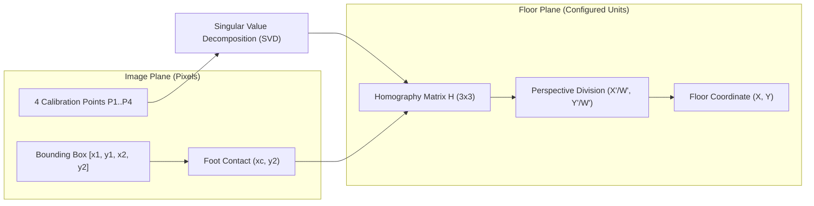

### 5.4 Zone Assignment & Temporal Hysteresis
- **Convex Polygon Containment:** Ray-casting algorithm tests whether $(X, Y)$ falls within configured retail zones (e.g., `shelf_a`, `browsing_aisle`, `checkout`).
- **Temporal Hysteresis Buffer:** When shoppers hover near boundary edges, minor tracking noise can cause rapid oscillation between adjacent zones. A 3-frame history window ensures that zone transitions trigger only after 3 consecutive frames in the new zone:
  $$\text{Zone}(t) = \begin{cases} Z_{\text{new}}, & \text{if } \text{RawZone}(t) = \text{RawZone}(t-1) = \text{RawZone}(t-2) = Z_{\text{new}} \\ \text{Zone}(t-1), & \text{otherwise} \end{cases}$$

### 5.5 Traffic Density & Strict Point Conservation
The retail floor is discretized into a uniform grid (default: $0.5 \times 0.5$ units). Every transformed trajectory point $(X_i, Y_i)$ is accumulated into a cell $(r, c)$. To prevent silent data loss, the pipeline asserts the Point Conservation Invariant at runtime:
$$\text{Total Evaluated Points} = \sum_{r} \sum_{c} \text{Grid}(r, c) + N_{\text{out-of-bounds}}$$
If the sum of binned points and boundary-rejected points diverges from total points by even a single observation, an assertion error is raised.

### 5.6 Dwell Episodes & Markovian Transitions
- **Dwell Episode Extraction:** Continuous sequences of frames in which a track stays within a zone are aggregated into episodes with start time $t_{\text{start}}$, end time $t_{\text{end}}$, and duration $\Delta t = t_{\text{end}} - t_{\text{start}}$.
- **Direct Transitions:** Computes empirical transition probabilities $P(Z_j \mid Z_i)$ from consecutive zone visits along recorded track trajectories. If a customer steps into unassigned floor space (`zone_id = None`), the direct transition chain breaks.

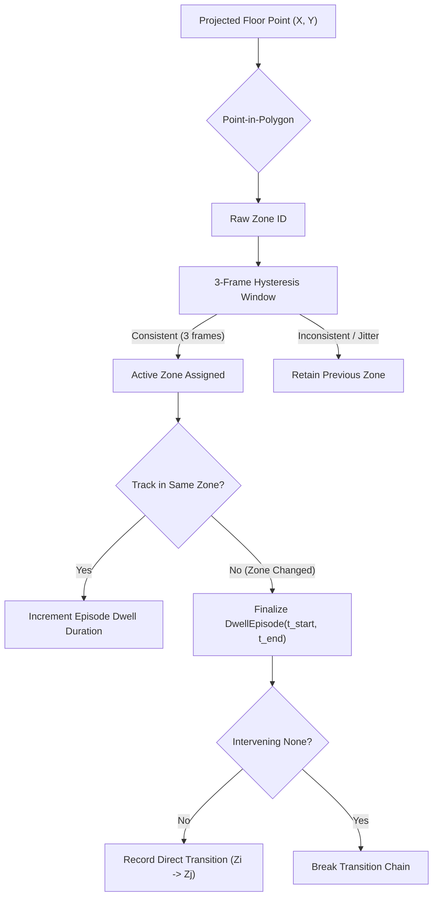

### 5.7 Candidate Diagnostics & Evidence Gating
Identifies prime display locations based on empirical traffic:
1. **Candidate Zone Selection:** Identifies the display or shelf zone with the highest observed dwell time.
2. **Hotspot Cell Pinpointing:** Within that candidate zone, finds the specific $0.5 \times 0.5$ grid cell exhibiting maximum accumulated density.
3. **Evidence Gating:** If observed tracking frames or visit episodes fall below minimum statistical thresholds (e.g. boundary truncation in MERL), layout recommendations are flagged with an explicit `WITHHELD` status to prevent unwarranted commercial claims.

---

## 6. Streamlit Dashboard Architecture

The dashboard provides an intuitive, non-technical interface for store owners and evaluators:

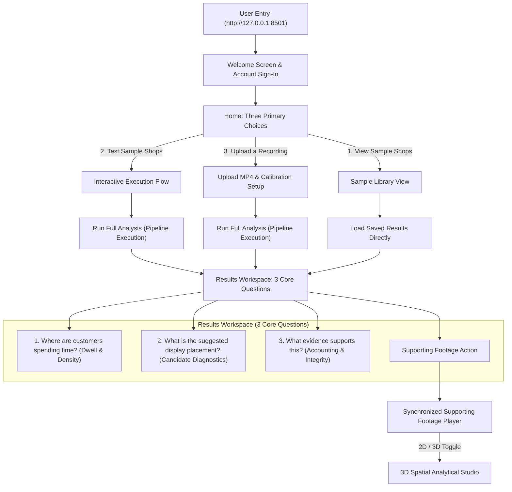

---

## 7. Visual Interface & Authentic Screen Walkthrough

### 7.1 Executive Results & Three Core Questions Layout
Presents store managers with direct, understandable answers supported by quantitative metrics:


### 7.2 Cumulative Traffic Density Heatmap
Displays spatial traffic concentration across retail aisles, highlighting dwell hotspots:

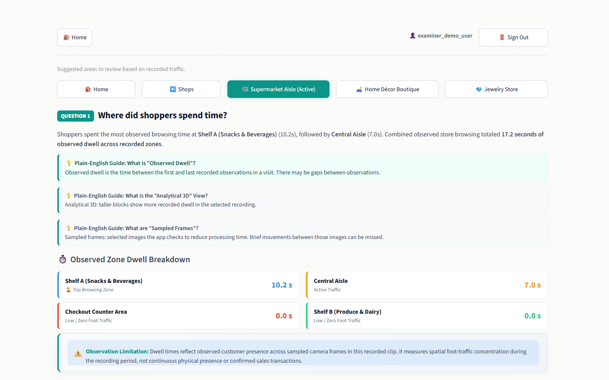

### 7.3 Trajectory Reconstruction & Floor Mapping
Renders 2D customer movement paths projected from camera space into configured store floor coordinates:


### 7.4 Synchronized Supporting Footage & Episode Timeline
Enables frame-accurate visual inspection of any visit episode with synchronized bounding boxes, trajectory trails, and timeline scrubbing:

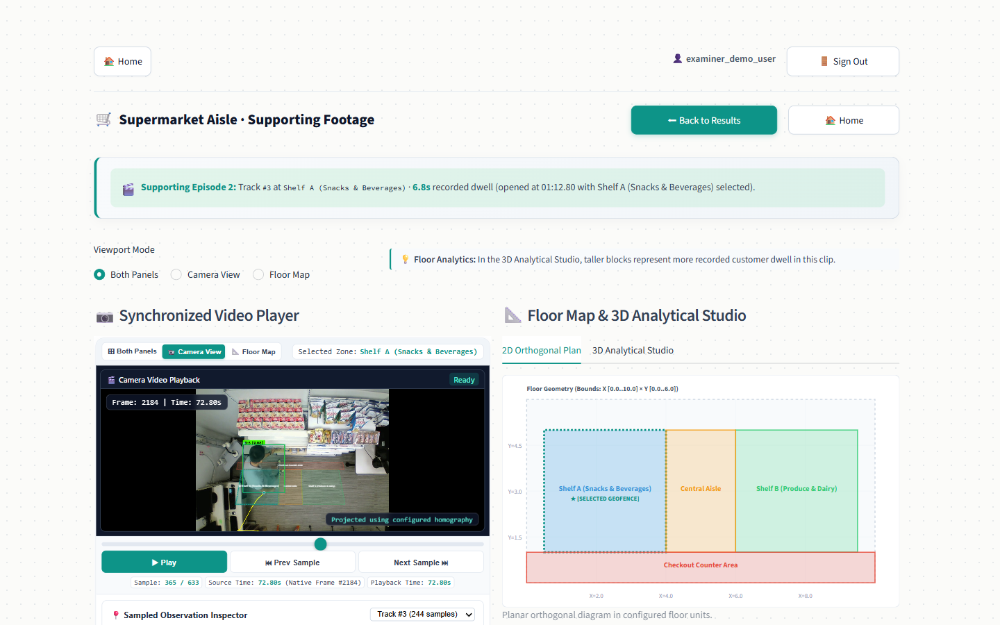

### 7.5 3D Spatial Analytical Studio
Allows operators to toggle between orthographic 2D floor plans and interactive 3D isometric views to inspect spatial dwell heights:

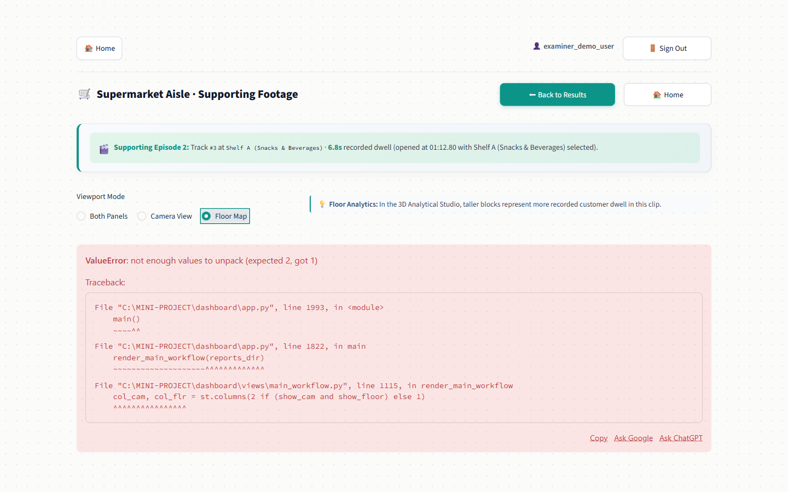

### 7.6 Home Décor Boutique Analytics
Demonstrates multi-zone candidate evaluation across boutique retail floor layouts:

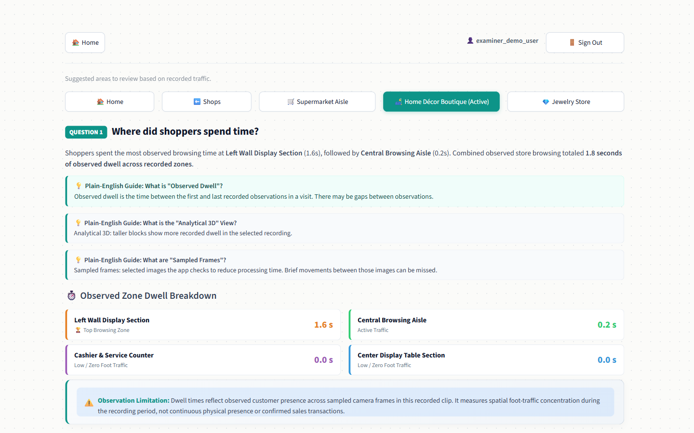

### 7.7 Luxury Jewelry Store Analytics
Evaluates customer approach trajectories and counter dwell times in a boutique luxury retail environment:

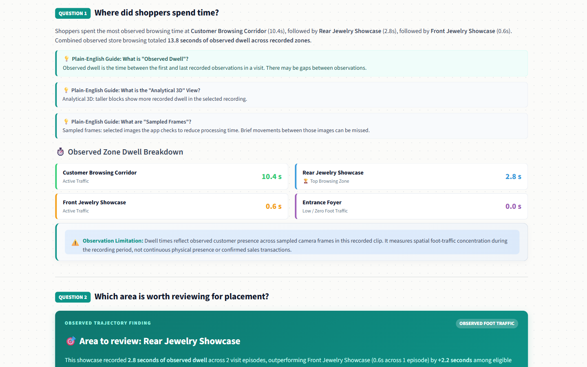

---

## 8. Pre-Configured Demonstration Shops

The repository includes pre-calibrated scene configurations and verified baseline outputs for three real-world retail environments:

| Retail Scene | Video Asset | Floor Bounds | Configured Zones | Observed Behavior & Candidate Placement |
| :--- | :--- | :---: | :--- | :--- |
| **Supermarket Aisle** (MERL) | `data/merl/10_1_crop.mp4` | $[0, 10] \times [0, 6]$ units | `shelf_a`, `shelf_b`, `main_aisle`, `checkout` | 3 tracks, 633 frames; `shelf_a` is the leading candidate (10.2s dwell across 3 episodes) |
| **Home Décor Boutique** (Site 03) | `data/prcv_site03_boutique.mp4` | $[0, 10] \times [0, 9]$ units | `side_display_left`, `center_aisle`, `display_table_center`, `checkout_counter` | 5 tracks, 134 frames; `side_display_left` is the leading candidate (1.6s dwell across 1 episode) |
| **Luxury Jewelry Store** (Site 02) | `data/prcv_site02_jewelry.mp4` | $[0, 8] \times [0, 9]$ units | `showcase_display_front`, `showcase_display_back`, `browsing_aisle`, `entrance_foyer` | 4 tracks, 73 frames; `showcase_display_back` is the leading candidate (2.8s dwell across 2 episodes) |

---

## 9. Installation, Setup & Execution

### 9.1 Environment Prerequisites
- **Operating System:** Windows 10/11, macOS, or Linux
- **Python:** Python 3.10 to 3.14 (tested on Python 3.12 / 3.14)
- **Hardware:** Commodity CPU (4+ cores, 4 GB RAM minimum)

### 9.2 Local Installation
```bash
# Clone the repository
git clone https://github.com/KanigaKP/Vision-Based-Customer-Trajectory-Analytics.git
cd Vision-Based-Customer-Trajectory-Analytics

# Create and activate a clean virtual environment
python -m venv venv

# Windows:
.\venv\Scripts\activate
# Linux / macOS:
source venv/bin/activate

# Install required dependencies
pip install -r requirements.txt
```

### 9.3 System Preflight Verification
Before launching the dashboard, execute the automated preflight checker to verify module compatibility, scene profiles, and port availability:
```bash
python scripts/check_prerequisites.py
```

### 9.4 Running the Application
On Windows systems, launch the application with the one-click launcher:
```cmd
start_demo.cmd
```
Alternatively, launch via the Streamlit CLI:
```bash
streamlit run dashboard/app.py --server.port 8501
```
Open **`http://localhost:8501`** in any modern web browser.

---

## 10. Clean-Clone Reproducibility & External Asset Setup

To respect intellectual property, licensing boundaries, and repository size constraints, neural model weights (`*.onnx`) and third-party video recordings (`*.mp4`) are excluded from Git commits. 

### 10.1 Functional Breakdown: Clean Clone vs. External Assets

| Operational Capability | Clean Clone (No External Assets) | Requires `yolo11n.onnx` | Requires Video Files (`*.mp4`) |
| :--- | :---: | :---: | :---: |
| **Pure Python Unit & Math Tests** | **READY** | Not Required | Not Required |
| **Homography SVD & Coordinate Transforms** | **READY** | Not Required | Not Required |
| **Zone Containment & 3-Frame Hysteresis** | **READY** | Not Required | Not Required |
| **Point-Conservation Density Grids** | **READY** | Not Required | Not Required |
| **Markovian Transition Probability Matrices**| **READY** | Not Required | Not Required |
| **Candidate Diagnostics & Tie-Breaking** | **READY** | Not Required | Not Required |
| **Report Serialization & Schema Parsers** | **READY** | Not Required | Not Required |
| **Live Neural Person Detection** | Blocked | **REQUIRED** | Not Required (accepts camera/images) |
| **Full Video Processing from Scratch** | Blocked | **REQUIRED** | **REQUIRED** |
| **Synchronized Video Player in Browser** | Blocked | Not Required | **REQUIRED** |

### 10.2 Automated Test Execution on a Clean Clone
- **Tests Passing Immediately on Clean Clone (Offline Fixtures):**
  The mathematical, spatial, and analytical algorithms run on synthetic test fixtures and pass out-of-the-box:
  ```bash
  pytest tests/test_homography.py tests/test_zones.py tests/test_dwell.py tests/test_density.py tests/test_transitions.py tests/test_candidate_diagnostics.py -q
  ```
- **Tests Requiring `yolo11n.onnx` and Video Files:**
  End-to-end integration suites (`tests/test_detection.py`, `tests/test_startup_prerequisites.py`, `tests/test_main_workflow.py`) require the model and video assets in their expected local paths.

### 10.3 Expected Directory Layout for Local Assets
When configuring the environment for complete video analysis:
```
data/
├── models/
│   └── yolo11n.onnx                 # YOLO11-nano ONNX weights (10.22 MB)
├── merl/
│   └── 10_1_crop.mp4                # Supermarket Aisle video (14.59 MB)
├── prcv_site03_boutique.mp4         # Boutique video (3.81 MB)
└── prcv_site02_jewelry.mp4          # Jewelry store video (1.21 MB)
```

### 10.4 Obtaining Required Assets
1. **YOLO11-nano ONNX Model:** Export directly using the official Ultralytics CLI:
   ```bash
   pip install ultralytics
   yolo export model=yolo11n.pt format=onnx imgsz=640 opset=17
   # Move the exported file to data/models/yolo11n.onnx
   ```
2. **Surveillance Video Clips:**
   - **MERL Shopping Dataset:** Courtesy of Mitsubishi Electric Research Laboratories (MERL). Used for academic research.
   - **PRCV Retail Dataset:** Courtesy of Pattern Recognition and Computer Vision retail benchmarking research.
   - *Custom Footage:* You can upload any standard MP4 surveillance recording directly through the dashboard UI (**Home → Upload a Recording**).

### 10.5 Asset Verification Command
Verify the presence and integrity of all required assets:
```bash
python scripts/check_prerequisites.py
```

---

## 11. Verification Methodology & Automated Test Suite

The project includes an automated test suite comprising 40 modular test files that validate unit functions, mathematical invariants, spatial coordinate transforms, and full pipeline integration:

```bash
# Execute the complete automated test suite
pytest tests/ -q
```

### Verified Test Run Results:
```
........................................................................ [ 16%]
........................................................................ [ 33%]
........................................................................ [ 50%]
........................................................................ [ 67%]
........................................................................ [ 84%]
....................................................................     [100%]
428 passed in 85.48s (0:01:25)
```

### Test Scope Coverage:
- **`test_homography.py` / `test_homography_validation.py`:** SVD solver stability, invertibility, quadrilateral convexity, and collinear point rejection.
- **`test_zones.py` / `test_zone_validation.py`:** Ray-casting polygon intersection, boundary distance calculations, and multi-zone overlap checks.
- **`test_dwell.py` / `test_hysteresis_validation.py`:** 3-frame buffer state transitions, episode duration math, and boundary oscillation damping.
- **`test_density.py`:** Mathematical assertion of the Point Conservation Invariant across various grid cell configurations.
- **`test_transitions.py`:** First-order Markov chain transitions, unassigned observation handling, and transition matrix normalization.
- **`test_candidate_diagnostics.py`:** Rule-based candidate zone identification, tie-breaking, and evidence gating logic.
- **`test_auth_and_welcome.py`:** PBKDF2 password hashing, session lifecycle, and route protection.

---

## 12. Known Limitations & Future Improvements

### Identified Limitations:
1. **Configured Floor Units vs. Surveyed Meters:** Floor coordinates represent configured scale units derived from user-selected quadrilateral points $(P_1 \dots P_4)$. They provide proportional spatial relationships but cannot substitute for millimeter-exact laser surveying.
2. **Single-Camera Field of View:** The current pipeline operates on single-camera video streams. Multi-camera handover across non-overlapping views is not supported in this prototype.
3. **Clip-Local Tracking:** Tracker identity associations are maintained only within a single recording. Re-identification across different days or cameras is excluded by design to protect shopper privacy.
4. **Non-Prescriptive Analytics:** Dwell hotspots indicate customer physical presence, but cannot infer purchase intent, transaction values, or customer demographics without external POS integration.

### Future Engineering Roadmap:
- [ ] **Cross-Camera Handover:** Integrate lightweight feature embeddings to link customer journeys across adjacent surveillance cameras.
- [ ] **Automatic Floor Calibration:** Develop automatic vanishing-point and floor-plane estimation to streamline camera setup.
- [ ] **3D Human Bounding Volumes:** Incorporate 3D ground bounding boxes to separate seated shoppers, standing dwell, and reach interactions with elevated shelves.
- [ ] **Edge Hardware Deployment:** Benchmark ONNX Runtime performance on ARM architectures (Raspberry Pi 5, NVIDIA Jetson).

---

## 13. Author & Academic Information

- **Candidate:** Kaniga Parameswaran R
- **Register Number:** 250282601051
- **Degree:** Master of Computer Applications (MCA)
- **Course Code:** CAF7104 — Mini Project
- **Department:** Department of Computer Applications
- **Institution:** B.S. Abdur Rahman Crescent Institute of Science and Technology, Vandalur, Chennai – 600 048, Tamil Nadu, India
- **Portfolio:** [kanigaparameswaran.netlify.app](https://kanigaparameswaran.netlify.app/)
- **GitHub:** [KanigaKP](https://github.com/KanigaKP)
