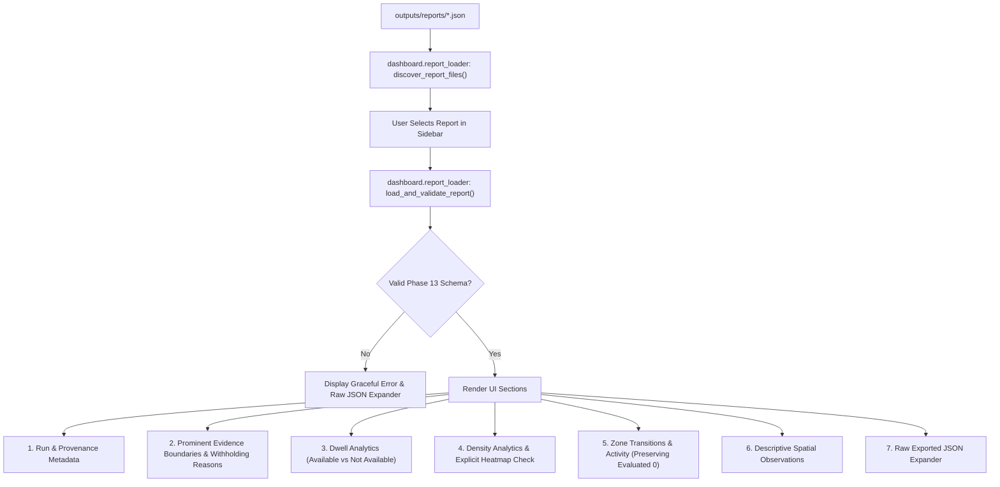

# Phase 14 — Local Streamlit Viewer for Analysis Reports

**Project**: Vision-Based Customer Trajectory Analytics for Retail Layout Optimization  
**Roadmap Phase**: Phase 14 — Interactive Visualization & Dashboard (Slice 14.1: Report Viewer & Slice 14.2: Enable and Smoke-Test)  
**Status**: COMPLETE / OPERATIONALLY VERIFIED  
**Regression Baseline**: 227/227 tests passing (213 baseline + 14 Phase 14 viewer & UI smoke tests)  
**Verification Runners**:
- [`scripts/verify_phase_08.py`](file:///c:/Users/sarca/OneDrive/Documents/projects/Vision-Based-Customer-Trajectory-Analytics/scripts/verify_phase_08.py): PASSED (70/70 component validation tests)
- [`scripts/verify_phase_10.py`](file:///c:/Users/sarca/OneDrive/Documents/projects/Vision-Based-Customer-Trajectory-Analytics/scripts/verify_phase_10.py): PASSED (MOT17 sequential frame and MERL video container pipeline checks)

---

## 1. Executive Summary & Objective

Phase 14 implements a lightweight, local-only viewer designed to allow reviewers to inspect existing Phase 13 JSON analysis reports exported to `outputs/reports/`. The viewer provides complete visibility into what analytics are available, missing, or withheld, while preserving all methodological invariants and evidence boundaries established in Phases 8–13.

### Dependency & Runtime Status (Phase 14.2):
- **Dependency Declaration**: `streamlit` is formally declared in [`requirements.txt`](file:///c:/Users/sarca/OneDrive/Documents/projects/Vision-Based-Customer-Trajectory-Analytics/requirements.txt).
- **Environment Status**: Per Phase 14.2 authorization, the declared `streamlit` package was installed into the virtual environment (`.\venv`) as `streamlit-1.66.1`. No other packages were upgraded or altered.
- **Server Execution**: The Streamlit server is actively running locally on `http://localhost:8501`.
- **Decoupled Architecture**: All report discovery, validation, parsing, and evidence gating logic is implemented in a pure standard-library module ([`dashboard/report_loader.py`](file:///c:/Users/sarca/OneDrive/Documents/projects/Vision-Based-Customer-Trajectory-Analytics/dashboard/report_loader.py)), tested independently via unit tests, while [`dashboard/app.py`](file:///c:/Users/sarca/OneDrive/Documents/projects/Vision-Based-Customer-Trajectory-Analytics/dashboard/app.py) provides the Streamlit presentation layer, verified via `AppTest` runtime smoke tests.

---

## 2. Core Architectural & Methodological Invariants

1. **Content-Based Provenance (No Filename Guessing)**:
   - Discovers local JSON files from `outputs/reports/`.
   - Reads `source_type`, `dataset_name`, and `evidence_context` directly from parsed JSON dictionary keys, **never inferring metadata or evidence status from the report filename**.
2. **Explicit Missing vs. Zero Accounting**:
   - Accurately renders `"not_available"` sections with the caller's explicit unsupplied reason.
   - Preserves evaluated zero counts (e.g. an evaluated store aisle with 0 visit runs) as numeric `0`, clearly distinguishing empirical zeroes from unsupplied metrics.
3. **Prominent Evidence Boundaries & Mandatory Statements**:
   - Displays prominent alerts for Phase 12 evidence gating status (`is_eligible`, `reasons_withheld`).
   - Automatically attaches required contextual limitation statements based on report content:
     - **MERL Context**: *"The local MERL run is an operational engineering check on recorded video that produced a sparse, boundary-truncated trajectory density result (100 sampled frames, severe camera field-of-view cutoff). It does NOT support retail layout recommendations, zone rankings, or quantitative validation."*
     - **MOT17 Context**: *"The local MOT17-04 sequence is a non-retail outdoor pedestrian image-sequence engineering check. It does NOT represent a retail store environment and does NOT support retail layout recommendations or quantitative validation."*
     - **General Boundary**: *"Neither synthetic fixtures, sample image sequences, nor sparse operational runs support retail layout recommendations, zone rankings, customer intent claims, or quantitative accuracy assertions."*
4. **Explicit Heatmap Resolution (No Image Pairing Heuristics)**:
   - A heatmap image is rendered IF AND ONLY IF the report dictionary explicitly contains a valid, existing file reference (`heatmap_image_path`).
   - If no explicit reference exists, the image is omitted with an informative message. The viewer never attempts to pair images based on filenames (e.g., matching `phase_10_density_heatmap_merl.png` to `phase_13_analysis_report_merl_sample.json`).
5. **Privacy & Clip-Local Tracker Identity Boundaries**:
   - Prohibits personal identities, names, faces, or raw trajectory coordinate sequences.
   - All track counts are explicitly designated as clip-local tracker IDs assigned by ByteTrack, noting potential upward bias from tracking fragmentation.
6. **Strictly Read-Only & Local**:
   - Never writes to disk, accepts live streams, or contacts external networks.
   - Prohibits sales prediction, customer intent speculation, zone rankings ("most popular"), or automatic layout recommendations.

---

## 3. UI Component Architecture ([`dashboard/app.py`](file:///c:/Users/sarca/OneDrive/Documents/projects/Vision-Based-Customer-Trajectory-Analytics/dashboard/app.py))

---

## 4. Verification & Test Inventory

The test suite [`tests/test_dashboard_report_viewer.py`](file:///c:/Users/sarca/OneDrive/Documents/projects/Vision-Based-Customer-Trajectory-Analytics/tests/test_dashboard_report_viewer.py) provides 14 focused tests verifying report loader behavior and actual Streamlit UI runtime via `AppTest`:

| Test Name | Verifies |
|---|---|
| `test_discover_report_files_in_existing_directory` | Discovers existing JSON files in `outputs/reports/`. |
| `test_discover_report_files_nonexistent_or_empty_directory` | Returns empty list for missing or empty directories without error. |
| `test_load_and_validate_merl_sample_report` | Parses MERL report, reads content-based `source_type="recorded_video"`, verifies boundary-truncated caveats, and verifies heatmap omission when unreferenced. |
| `test_load_and_validate_mot17_sample_report` | Parses MOT17 report, reads content-based `source_type="image_sequence"`, and attaches non-retail pedestrian context statement. |
| `test_load_malformed_json_syntax` | Catches syntax errors gracefully without raising uncaught exceptions. |
| `test_load_non_object_root_json` | Rejects non-dict root JSON gracefully. |
| `test_load_unsupported_or_missing_schema_version` | Rejects unsupported or missing schema versions with clear error message. |
| `test_file_not_found_handled_gracefully` | Returns `is_valid=False` for missing file path without crashing. |
| `test_missing_versus_zero_metric_preservation` | Accurately distinguishes unsupplied (`"not_available"`) sections from evaluated numeric zeroes (`"available"` with count 0). |
| `test_explicit_heatmap_artifact_resolution_never_guesses_filename` | Strictly resolves explicit existing heatmap paths; never guesses based on filename similarity. |
| `test_privacy_boundaries_in_parsed_report` | Ensures absence of raw customer identities, personal names, sales, and raw trajectory coordinates. |
| `test_streamlit_app_runtime_smoke_test_merl_view` | **UI Runtime Smoke Test**: Verifies default MERL report rendering, metadata, mandatory sparse/boundary-truncated warnings, Phase 12 gating banner, density metrics, omitted heatmap notice, and unavailable sections. |
| `test_streamlit_app_runtime_smoke_test_mot17_view` | **UI Runtime Smoke Test**: Verifies switching to MOT17 renders non-retail outdoor pedestrian context statement and gating notice. |
| `test_streamlit_app_runtime_handles_unsupported_report` | **UI Runtime Smoke Test**: Verifies selecting unsupported/older JSON report displays graceful error banner without crashing the application. |

---

## 5. Evidence Classification Matrix

| Component | Implemented | Operationally Verified | Quantitatively Validated | Retail-Performance Validated | Empirical Boundary / Limitation |
|---|:---:|:---:|:---:|:---:|---|
| **Local Report Discovery & Loader** ([`dashboard/report_loader.py`](file:///c:/Users/sarca/OneDrive/Documents/projects/Vision-Based-Customer-Trajectory-Analytics/dashboard/report_loader.py)) | **YES** | **YES** | **NO** | **NO** | Discovers and validates JSON reports on local disk; operationally verified by 11 unit tests in [`test_dashboard_report_viewer.py`](file:///c:/Users/sarca/OneDrive/Documents/projects/Vision-Based-Customer-Trajectory-Analytics/tests/test_dashboard_report_viewer.py). |
| **Streamlit Viewer UI** ([`dashboard/app.py`](file:///c:/Users/sarca/OneDrive/Documents/projects/Vision-Based-Customer-Trajectory-Analytics/dashboard/app.py)) | **YES** | **YES** (UI Runtime Verified) | **NO** | **NO** | Interactive viewer runtime operationally verified via 3 Streamlit `AppTest` smoke tests and live local Uvicorn/Streamlit daemon server on `http://localhost:8501`. |
| **Evidence Gating & Disclaimers** | **YES** | **YES** | **NO** | **NO** | Transparently renders Phase 12 `insufficient_evidence` reasons and MERL/MOT17 contextual statements in report structures; does not upgrade evidence tier. |
| **Explicit Heatmap Resolution** | **YES** | **YES** | **NO** | **NO** | Verified to only resolve heatmaps if explicitly referenced in report payload; never pairs by filename. |

> [!IMPORTANT]
> **Methodological Boundary**: A local viewer interface is a presentation utility for inspection of software artifacts. Running or viewing reports **does NOT establish empirical tracking accuracy, physical ground truth, or retail layout performance.**

---

*Phase 14 complete (Phase 14.1 viewer implementation & Phase 14.2 installation/smoke testing). Execution halts strictly here without proceeding to Phase 15 (Final Integration/Evaluation).*

